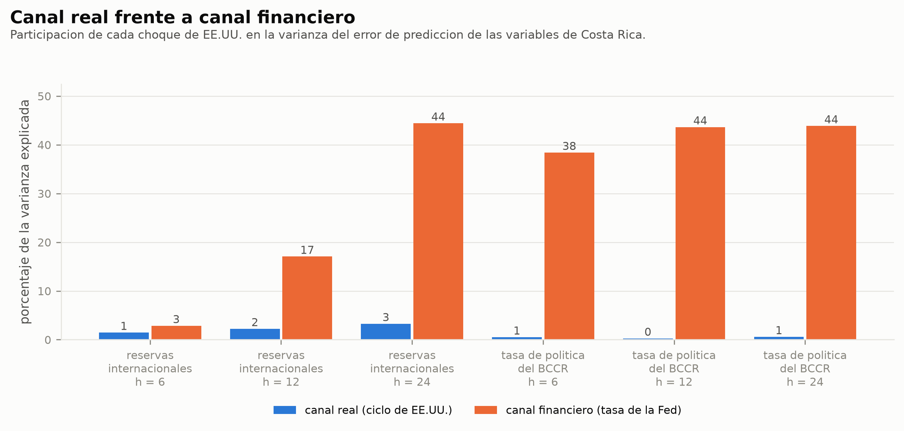
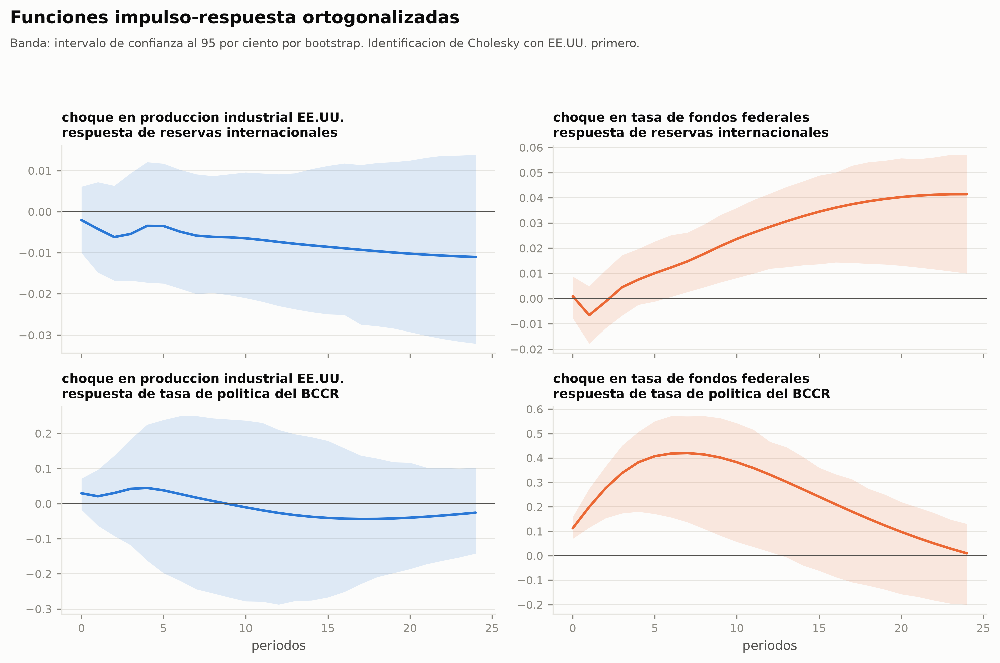

# Efecto del ciclo económico y la política monetaria de EE.UU. sobre el sector externo de Costa Rica, 2015–2025

Investigación con **datos reales y públicos** sobre cómo se transmiten a Costa Rica
los dos canales por los que Estados Unidos afecta a una economía pequeña y abierta:
el **canal real** (su ciclo económico mueve la demanda de exportaciones) y el
**canal financiero** (la tasa de la Fed mueve los flujos de capital).

El pipeline corre de punta a punta: lee los datos, prueba raíces unitarias, prueba
cointegración, estima tres bloques VAR/VECM, y produce 26 figuras a 300 dpi, 31
tablas y un reporte en markdown.

> **Autoría.** Este repositorio es trabajo propio de José Pablo Guerrero Chaves y
> corresponde a su Trabajo Final de Graduación (Licenciatura en Economía,
> Universidad Latina de Costa Rica), con anteproyecto aprobado. Los datos son
> públicos: FRED y el portal de indicadores del BCCR. El historial de commits
> documenta la autoría y las fechas.

## Resultado principal

**El canal financiero domina al canal real en las 14 combinaciones de variable y
horizonte que produce el pipeline.** Porcentaje de la varianza del error de
predicción atribuido a cada canal:

| Variable de Costa Rica | Bloque | Horizonte | Canal real | Canal financiero |
|---|---|---:|---:|---:|
| Reservas internacionales netas | financiero | 24 meses | 3,3 % | **44,4 %** |
| Tasa de política monetaria del BCCR | financiero | 24 meses | 0,6 % | **43,9 %** |
| ITCER (competitividad) | comercial | 24 meses | 4,5 % | **43,2 %** |
| Exportaciones FOB | comercial | 24 meses | 6,2 % | 10,4 % |
| Cuenta financiera de la balanza de pagos | balanza de pagos | 12 trimestres | 2,8 % | **26,1 %** |



La lectura no es que el canal real no exista, sino que **es débil frente al
financiero incluso en la variable donde debería mandar**: sobre las exportaciones,
el canal real explica 6,2 % a dos años. La transmisión de EE.UU. a Costa Rica en
este período pasa mucho más por la tasa de la Fed que por el ciclo industrial
estadounidense.

Los detalles, con las pruebas de diagnóstico y las limitaciones, están en
[`salidas/reporte.md`](salidas/reporte.md).

### Cómo responde Costa Rica a un alza de la Fed



Las bandas son intervalos bootstrap. Donde la banda cruza el cero, el efecto no
es distinguible de cero: eso también es un resultado y se reporta.

## Correr

```bash
pip install -r requirements.txt
python main.py                          # los tres bloques
python main.py --bloque financiero      # solo uno
```

Una corrida completa desde cero reproduce el reporte carácter por carácter salvo la
fecha de generación.

| Ruta | Qué es |
|---|---|
| `salidas/reporte.md` | resultados narrados, con las tablas de cada prueba |
| `salidas/figuras/*.png` | 26 figuras a 300 dpi |
| `salidas/tablas/*.csv` | cada prueba estadística en su propio CSV |
| `data/procesado/` | el panel armado y el registro de origen de cada serie |

## Los datos

**Estados Unidos — FRED**, público y sin llave. Se cachea en `data/raw/cache/`
porque FRED limita la frecuencia de peticiones y el análisis tiene que poder
correr sin red.

| Serie | Código |
|---|---|
| Producción industrial (ciclo real, mensual) | `INDPRO` |
| Tasa de fondos federales | `FEDFUNDS` |
| PIB real trimestral | `GDPC1` |
| Bono del Tesoro a 2 años | `DGS2` |
| Índice amplio del dólar | `DTWEXBGS` |

**Costa Rica — BCCR**, descargados a mano del portal público de indicadores
económicos (https://sdd.bccr.fi.cr/es/IndicadoresEconomicos/Inicio/) y puestos en
`data/raw/`. Son cuadros abiertos, sin login ni credenciales:

| Archivo | Cuadro del BCCR | Tratamiento |
|---|---|---|
| `tipo_cambio.xlsx` | Contenedor/6?Cuadro=1 | diario → promedio mensual, columna de venta |
| `balance_comercial.xlsx` | Contenedor/452?Cuadro=112 | **desacumulado**: el BCCR lo publica acumulado en el año |
| `reservas.xlsx` | Contenedor/516?Cuadro=70 | saldo de fin de mes |
| `tpm.xlsx` | Contenedor/358?Cuadro=223 | diario → promedio mensual |
| `itcer.xlsx` | buscar «tipo de cambio efectivo real» en el portal | índice, base ene-1997 = 100 |
| `exportaciones.xlsx` | buscar «exportaciones FOB acumuladas» en el portal | **desacumulado**, régimen definitivo |
| `balanza_pagos.xlsx` | buscar «balanza de pagos trimestral MBP6» en el portal | trimestral, cuenta financiera |

`src/bccr_excel.py` lee el formato exacto que exporta ese portal (encabezado en la
fila 5) y resuelve la desacumulación. La verificación está en el código: la suma de
los flujos mensuales de un año reproduce el acumulado de diciembre con diferencia 0.

Para actualizar, se vuelven a bajar los Excel y se corre `main.py`. El portal carga
los cuadros por JavaScript y tiene protección antibot, así que no hay forma
razonable de automatizar la descarga sin el token del servicio web del BCCR.

## Los tres bloques y por qué

Cuatro variables con 132 observaciones mensuales es una relación sana entre
parámetros y datos. Meter las siete en un solo VAR no lo sería. Los bloques
comparten las variables de EE.UU. y cambian las de Costa Rica, de modo que la
descomposición de varianza de cada uno contesta la misma pregunta sobre una parte
distinta del sector externo:

- **Bloque comercial** — `ipi_eeuu`, `ffr`, `export_cr`, `itcer` (132 obs, 3 rezagos)
  El canal real y el financiero sobre las exportaciones y sobre la competitividad.
- **Bloque financiero** — `ipi_eeuu`, `ffr`, `reservas`, `tpm` (132 obs, 3 rezagos)
  La transmisión hacia las reservas y la respuesta de política del BCCR.
- **Bloque balanza de pagos** — `pib_eeuu`, `ffr`, `cuenta_fin` (44 obs, 2 rezagos)
  Los flujos de capital medidos directamente. Trimestral y deliberadamente
  parsimonioso: con ~44 observaciones, tres variables es el techo defendible.

`tc_venta` y `balcom` se construyen y quedan en el panel, pero **no entran en
ningún bloque**: el ITCER es mejor medida de competitividad que el tipo de cambio
nominal, y las exportaciones son más informativas que el saldo comercial neto.

## Decisiones metodológicas que hay que poder defender

- **Identificación de Cholesky con EE.UU. ordenado primero.** Costa Rica es una
  economía pequeña y abierta: no se le supone efecto contemporáneo sobre EE.UU. Es
  razonable, pero es un supuesto. Conviene reportar la robustez invirtiendo el orden
  de las dos variables ticas.
- **Dummy exógena para el COVID** (marzo–agosto 2020, y 2020T1–2020T2 en el bloque
  trimestral). Sin ese control, 2020 domina la estimación y las respuestas al
  impulso se vuelven irreconocibles.
- **Rezagos por HQIC.** AIC sobreparametriza con muestras cortas y BIC se queda
  corto. El CSV `06_seleccion_rezagos_*` trae los tres criterios.
- **ADF y KPSS juntos.** Tienen hipótesis nulas opuestas. Cuando se contradicen, la
  fila queda marcada como `ambiguo` en vez de forzar una conclusión.
- **Producción industrial como medida mensual del ciclo real.** El PIB solo existe
  trimestral y 44 trimestres no alcanzan para un VAR mensual. Es una decisión de
  frecuencia, no una equivalencia. El bloque trimestral sí usa el PIB.

## Limitaciones

- **Hay autocorrelación remanente en los tres bloques.** El Portmanteau rechaza la
  nula en comercial (p = 0,0004), financiero (p = 0,0063) y balanza de pagos
  (p = 0,0252). Está en `08_diagnosticos_*.csv`. Obliga a leer los intervalos de
  confianza de las respuestas al impulso con cautela.
- **Los residuos no son normales en los dos bloques mensuales** (Jarque-Bera
  rechaza con p = 0). En el bloque trimestral no se rechaza (p = 0,377). Es habitual
  en series macro con el choque de 2020 adentro.
- **Las reservas suben tras un alza de la Fed**, que es lo contrario de la historia
  clásica de fuga de capitales. Casi seguro refleja el episodio 2022–2024, cuando
  Costa Rica acumuló reservas de forma agresiva mientras la Fed subía. Es una
  correlación de ese período, no una ley general, y así hay que presentarla.
- **El bloque trimestral tiene 44 observaciones.** Con 3 variables y 2 rezagos está
  en el límite de lo estimable. Sus resultados son indicativos, no concluyentes, y
  por eso se reportan a 6 y 12 trimestres y no más lejos.
- **La descomposición de varianza depende del orden de Cholesky.** Los porcentajes
  del cuadro de resultados cambiarían con otro ordenamiento de las variables ticas.
  La robustez a ese cambio está pendiente.

## Las 26 figuras

El pipeline produce 26 figuras a 300 dpi en `salidas/figuras/`. Las más útiles
para entender el trabajo sin clonarlo:

| Figura | Qué muestra |
|---|---|
| [`06_correlaciones.png`](salidas/figuras/06_correlaciones.png) | matriz de correlación entre las 12 series |
| [`08_niveles_vs_diferencias_comercial.png`](salidas/figuras/08_niveles_vs_diferencias_comercial.png) | por qué hay que diferenciar antes de estimar |
| [`10_johansen_financiero.png`](salidas/figuras/10_johansen_financiero.png) | la traza de Johansen contra su valor crítico |
| [`12_descomposicion_varianza_financiero.png`](salidas/figuras/12_descomposicion_varianza_financiero.png) | la descomposición completa, no solo los dos canales |

## Estructura

```
config.py              periodo, series, bloques de modelación, paleta
main.py                orquestador
src/fuentes.py         descarga y caché de FRED
src/bccr_excel.py      lector de los Excel del BCCR y desacumulación
src/dataset.py         armado del panel mensual y trimestral
src/graficos.py        estilo único de todas las figuras
src/descriptivo.py     estadísticas y figuras descriptivas
src/estacionariedad.py ADF y KPSS
src/cointegracion.py   Engle-Granger y Johansen
src/modelo.py          VAR/VECM, Granger, IRF, descomposición de varianza
src/reporte.py         arma salidas/reporte.md
```
