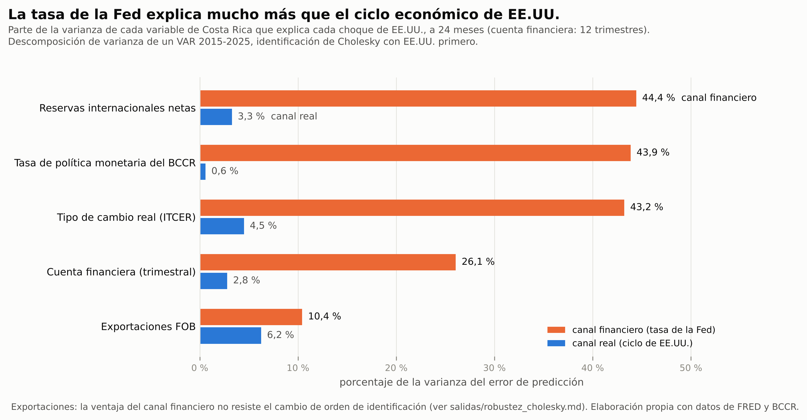
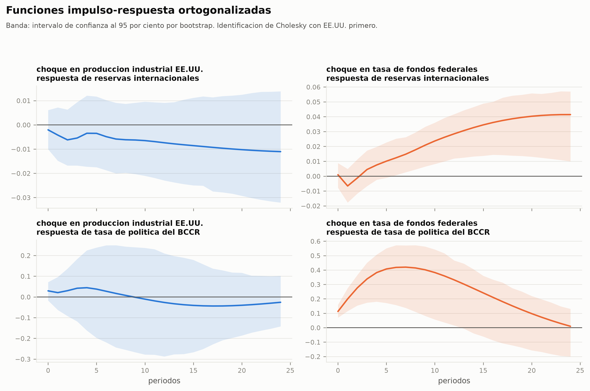

# ¿Qué mueve al sector externo de Costa Rica: el ciclo de EE. UU. o la tasa de la Fed?

Investigación econométrica en Python con datos públicos de FRED y del Banco Central de
Costa Rica (BCCR), 2015-2025.
**[Tablero interactivo](https://pabloguerrerocr.github.io/tfg/)** ·
[Resumen de 2 páginas (PDF)](https://pabloguerrerocr.github.io/tfg/resumen.pdf)

**Respuesta corta: la tasa de la Fed.** Explica entre el 26 % y el 44 % de la variación
de las reservas internacionales, la tasa de política del BCCR, el tipo de cambio real y
la cuenta financiera. El ciclo económico de EE. UU. no pasa del 5 % en ninguna de ellas.



## Pregunta

Estados Unidos afecta a una economía pequeña y abierta como Costa Rica por dos canales:

- **Canal real.** Cuando la economía estadounidense crece, compra más exportaciones
  costarricenses.
- **Canal financiero.** Cuando la Reserva Federal sube su tasa, cambian los flujos de
  capital, el tipo de cambio, las reservas y la política del BCCR.

¿Cuál de los dos pesó más entre 2015 y 2025?

## Tres hallazgos

**1. El canal financiero domina en las 14 combinaciones de variable y horizonte.**
A 24 meses, la tasa de la Fed explica el 44,4 % de la varianza del error de predicción
de las reservas internacionales netas, el 43,9 % de la tasa de política del BCCR y el
43,2 % del tipo de cambio real (ITCER). El ciclo industrial de EE. UU. explica 3,3 %,
0,6 % y 4,5 %, respectivamente. En la cuenta financiera, a 12 trimestres: 26,1 % frente
a 2,8 %.

**2. No depende del supuesto de identificación, salvo en las exportaciones.** Con la
descomposición generalizada de Pesaran y Shin (1998), que no depende del orden de las
variables, el canal financiero sigue ganando en 14 de 14 casos: explica entre 23,6 % y
38,9 % de reservas, tasa del BCCR, ITCER y cuenta financiera, y el canal real no pasa de
4,6 %. La excepción son las exportaciones, justo donde el canal real debería mandar: si
la Fed se ordena antes que el ciclo, el ciclo explica 8,9 % y la Fed 7,7 %. Sobre
exportaciones el resultado no es concluyente.

**3. Tras un alza de la Fed, el BCCR sube su tasa y las reservas suben, no caen.** Ante
un choque de una desviación estándar en la tasa de fondos federales (+0,11 puntos
porcentuales al impacto), la tasa del BCCR sube hasta +0,42 pp a los 7 meses, cuando la
propia tasa de la Fed va en +0,28 pp; la respuesta es significativa del mes 0 al 12. Las
reservas suben cerca de 4 % a los 24 meses (banda al 95 %: de +1 % a +6 %). Es lo
contrario de la historia clásica de fuga de capitales y coincide con 2022-2024: la tasa
de la Fed pasó de 0,08 % a 5,33 % entre enero de 2022 y agosto de 2023, y las reservas
de Costa Rica se duplicaron entre enero de 2022 y diciembre de 2024 (de unos US$6.800
a US$14.200 millones). Es una regularidad de ese período, no una ley general.



*Respuesta de las reservas (en logaritmos: 0,04 ≈ 4 %) y de la tasa del BCCR (en puntos
porcentuales) a un choque en el ciclo de EE. UU. (izquierda) y en la tasa de la Fed
(derecha). Donde la banda cruza el cero, el efecto no es distinguible de cero.*

## Datos

Todo es público y está versionado en el repositorio, así que el análisis corre sin
conexión. Muestra: enero de 2015 a diciembre de 2025 (132 meses, 44 trimestres).

| Variable | Fuente | Serie o cuadro | Frecuencia y tratamiento |
|---|---|---|---|
| Producción industrial de EE. UU. (ciclo real) | FRED | [`INDPRO`](https://fred.stlouisfed.org/series/INDPRO) | mensual, logaritmo |
| PIB real de EE. UU. (ciclo real, bloque trimestral) | FRED | [`GDPC1`](https://fred.stlouisfed.org/series/GDPC1) | trimestral, logaritmo |
| Tasa de fondos federales (canal financiero) | FRED | [`FEDFUNDS`](https://fred.stlouisfed.org/series/FEDFUNDS) | mensual, nivel |
| Exportaciones FOB | BCCR | Exportaciones FOB acumuladas, total, cifras preliminares (FUES) | mensual; se desacumula; logaritmo |
| Tipo de cambio real | BCCR | Índice de tipo de cambio efectivo real multilateral (ITCER), base enero 1997 = 100 | mensual, logaritmo |
| Reservas internacionales netas | BCCR | Reservas netas del Banco Central | saldo a fin de mes, logaritmo |
| Tasa de política monetaria | BCCR | Tasa de política monetaria | diaria a promedio mensual |
| Cuenta financiera | BCCR | Balanza de pagos trimestral (MBP6), cuenta financiera | trimestral, nivel (cambia de signo) |

FRED es la base de datos del Banco de la Reserva Federal de San Luis. Los cuadros del
BCCR vienen de su
[portal de indicadores económicos](https://sdd.bccr.fi.cr/es/IndicadoresEconomicos/Inicio/)
y están en `data/raw/` tal como los exporta el portal. El BCCR publica las exportaciones
acumuladas en el año; el código las convierte en flujos mensuales y verifica en cada
corrida que la suma de los flujos de cada año reproduce el acumulado de diciembre
(diferencia máxima de 2e-12 en 31 años). Para la parte descriptiva también se usan el
bono del Tesoro a 2 años (`DGS2`), el índice amplio del dólar (`DTWEXBGS`), el tipo de
cambio de venta y el balance comercial.

## Método

1. **Orden de integración.** ADF y KPSS, que tienen hipótesis nulas opuestas, en niveles
   y en primeras diferencias. Cuando se contradicen, la serie queda marcada como
   «ambigua» en lugar de forzar una conclusión.
2. **Cointegración.** Johansen (prueba de la traza, 5 %) y Engle-Granger par a par.
   Donde el rango es positivo se estima además un VECM.
3. **Tres VAR por bloques.** Los tres comparten las dos variables de EE. UU. (ciclo y
   tasa de la Fed) y cambian las de Costa Rica: *comercial* (exportaciones e ITCER),
   *financiero* (reservas y tasa del BCCR) y *balanza de pagos* (cuenta financiera,
   trimestral). Así cada modelo tiene 3 o 4 variables y no se sobreparametriza. Son VAR
   en niveles, consistentes aun con raíces unitarias y cointegración (Sims, Stock y
   Watson, 1990), con rezagos elegidos por HQIC (3, 3 y 2) y una variable dummy para el
   choque del COVID (marzo a agosto de 2020).
4. **Identificación.** Cholesky con EE. UU. primero: se supone que Costa Rica no mueve
   a EE. UU. dentro del mismo período. La **descomposición de la varianza** a 6, 12 y
   24 meses responde la pregunta. Las **funciones impulso-respuesta** llevan bandas al
   95 % por simulación (500 réplicas).
5. **Robustez y diagnóstico.** Se repite con los cuatro órdenes de Cholesky que dejan a
   EE. UU. primero y con la descomposición generalizada de Pesaran y Shin (1998). En
   cada bloque se prueban autocorrelación (Portmanteau), normalidad (Jarque-Bera) y
   estabilidad.

## Cómo correrlo

```bash
git clone https://github.com/pabloguerrerocr/sector-externo-cr-eeuu.git
cd sector-externo-cr-eeuu
pip install -r requirements.txt
python main.py        # los tres bloques: unos 20 segundos, sin conexión
```

| Comando | Qué hace |
|---|---|
| `python main.py --bloque financiero` | corre un solo bloque (`comercial`, `financiero` o `balanza_pagos`) |
| `python robustez_cholesky.py` | robustez al orden de identificación, en `salidas/robustez_cholesky.md` |
| `python exportar_tablero.py` | tablas del tablero interactivo (bandas de las IRF y descomposición por especificación) |
| `python main.py --descargar-fred` | baja la versión más reciente de FRED en lugar de usar la copia versionada |

Sin `--descargar-fred`, las series de EE. UU. salen de la copia local de FRED o, si no
existe, del panel versionado en `data/procesado/`. Un clon nuevo reproduce así las tablas
publicadas, con diferencias menores a 1e-8 (ruido de punto flotante entre sistemas).
Probado con Python 3.13, pandas 3.1 y statsmodels 0.15. Con `--descargar-fred` los
números pueden moverse un poco, porque FRED revisa sus series.

| Salida | Contenido |
|---|---|
| `salidas/reporte.md` | resultados narrados, con la tabla de cada prueba |
| `salidas/figuras/` | 27 figuras a 300 dpi |
| `salidas/tablas/` | 34 tablas CSV, una por prueba |
| `data/procesado/` | paneles mensual y trimestral, y el origen de cada serie |

## Limitaciones

- **Autocorrelación remanente** en los tres bloques (Portmanteau: p = 0,0004, 0,0063 y
  0,0252). Las bandas de las respuestas al impulso se leen con cautela.
- **Residuos no normales** en los bloques mensuales (Jarque-Bera, p < 0,001), algo
  habitual con 2020 en la muestra. En el bloque trimestral no se rechaza la normalidad
  (p = 0,377).
- **El bloque trimestral tiene 44 observaciones.** Sus resultados son indicativos y se
  reportan solo a 6 y 12 trimestres.
- **Es una asociación dinámica del período, no una ley.** Los años 2022-2024, con el
  alza de la Fed y la acumulación de reservas, pesan mucho en la estimación.
- **Aproximaciones de medida.** La producción industrial aproxima el ciclo real mensual,
  porque el PIB solo existe trimestral. El ITCER es multilateral, no bilateral con
  EE. UU.

<details>
<summary><b>Más detalle: bloques, cointegración, robustez completa y actualización de datos</b></summary>

### Por qué tres bloques y no un solo VAR

Con 132 observaciones mensuales, cuatro variables es una relación sana entre parámetros y
datos; las siete juntas no lo serían. Como todos los bloques comparten las variables de
EE. UU., la descomposición de varianza de cada uno contesta la misma pregunta sobre una
parte distinta del sector externo. El tipo de cambio nominal y el balance comercial se
construyen pero no entran en los modelos: el ITCER mide mejor la competitividad y las
exportaciones son más informativas que el saldo neto.

### Orden de integración y cointegración

En los bloques mensuales todas las series son I(1). En el trimestral, con 44
observaciones, el PIB de EE. UU. y la cuenta financiera salen estacionarios y la tasa de
la Fed queda ambigua, así que el rango 1 que encuentra Johansen puede reflejar eso más que
un equilibrio de largo plazo. Johansen encuentra rango 0 en el bloque comercial y rango 1
en el financiero. En el VECM del bloque financiero solo se ajustan significativamente las
variables de EE. UU. (p < 0,001); las reservas (p = 0,09) y la tasa del BCCR (p = 0,13)
no. Por eso el análisis descansa en el VAR en niveles y no en el vector de largo plazo.

### Robustez completa al orden de identificación

| Especificación | Combinaciones donde domina el canal financiero |
|---|---:|
| Base: EE. UU. primero, ciclo antes que la Fed | 14 de 14 |
| Variables de Costa Rica invertidas | 12 de 12 |
| Variables de EE. UU. invertidas (la Fed primero) | 11 de 14 |
| Ambos pares invertidos | 9 de 12 |
| Generalizada de Pesaran y Shin (no depende del orden) | 14 de 14 |

Invertir las variables de Costa Rica no mueve ningún porcentaje: con Cholesky, lo que
explican los choques de EE. UU. no depende del orden de las variables que van después.
La prueba que importa es invertir las de EE. UU., y ahí solo cambian las tres
combinaciones de exportaciones. El bloque trimestral tiene una sola variable de Costa
Rica, por eso dos especificaciones cuentan 12 combinaciones y no 14. Detalle en
[`salidas/robustez_cholesky.md`](salidas/robustez_cholesky.md).

### Actualizar los datos de Costa Rica

Se vuelven a bajar los Excel del portal del BCCR, se reemplazan en `data/raw/` y se corre
`main.py`. El portal carga los cuadros con JavaScript y tiene protección contra bots, así
que la descarga es manual.

| Archivo | Cuadro del BCCR | Tratamiento |
|---|---|---|
| `tipo_cambio.xlsx` | Contenedor/6?Cuadro=1 | diario a promedio mensual, columna de venta |
| `balance_comercial.xlsx` | Contenedor/452?Cuadro=112 | se desacumula |
| `reservas.xlsx` | Contenedor/516?Cuadro=70 | saldo de fin de mes |
| `tpm.xlsx` | Contenedor/358?Cuadro=223 | diario a promedio mensual |
| `itcer.xlsx` | buscar «tipo de cambio efectivo real» en el portal | índice, base enero 1997 = 100 |
| `exportaciones.xlsx` | buscar «exportaciones FOB acumuladas» en el portal | se desacumula; columna total, preliminares |
| `balanza_pagos.xlsx` | buscar «balanza de pagos trimestral MBP6» en el portal | trimestral, cuenta financiera |

### Otras figuras útiles

| Figura | Qué muestra |
|---|---|
| [`02_fed_vs_bccr.png`](salidas/figuras/02_fed_vs_bccr.png) | la tasa de la Fed y la del BCCR en un mismo eje |
| [`12_descomposicion_varianza_financiero.png`](salidas/figuras/12_descomposicion_varianza_financiero.png) | la descomposición completa, no solo los dos canales |
| [`08_niveles_vs_diferencias_comercial.png`](salidas/figuras/08_niveles_vs_diferencias_comercial.png) | por qué hay que tratar las raíces unitarias |
| [`06_correlaciones.png`](salidas/figuras/06_correlaciones.png) | correlaciones entre las tasas de variación de seis series |

</details>

## Estructura

```
config.py               período, series, bloques de modelación y paleta
main.py                 pipeline completo
robustez_cholesky.py    robustez al orden de identificación
exportar_tablero.py     tablas del tablero interactivo
src/fuentes.py          FRED: copia local o descarga
src/bccr_excel.py       lector de los Excel del BCCR y desacumulación verificada
src/dataset.py          paneles mensual y trimestral
src/estacionariedad.py  ADF y KPSS
src/cointegracion.py    Engle-Granger y Johansen
src/modelo.py           VAR y VECM, Granger, impulso-respuesta, descomposición de varianza
src/descriptivo.py      estadísticas y figuras descriptivas
src/graficos.py         estilo único de las figuras
src/reporte.py          arma salidas/reporte.md
```

## Autoría

Trabajo propio de José Pablo Guerrero Chaves, correspondiente a su Trabajo Final de
Graduación (Licenciatura en Economía, Universidad Latina de Costa Rica), con anteproyecto
aprobado. El historial de commits documenta la autoría y las fechas.
